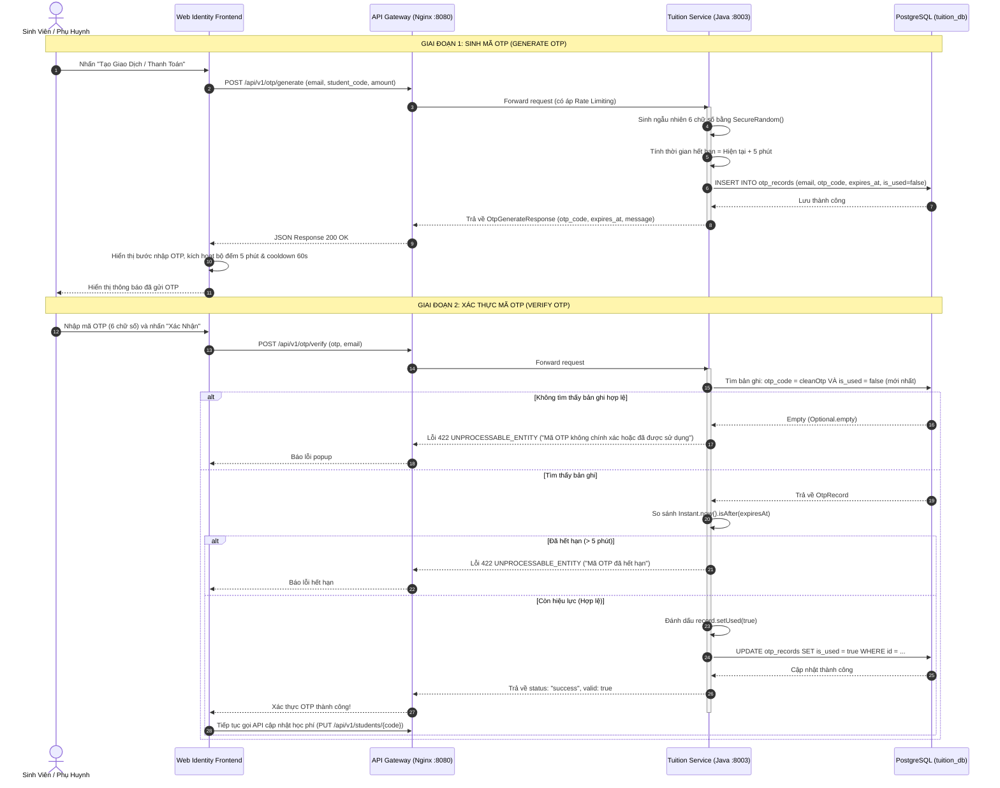
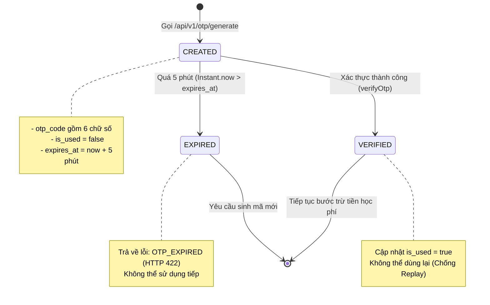

# TÀI LIỆU GIẢI THÍCH CHI TIẾT MÃ NGUỒN DỊCH VỤ XÁC THỰC OTP (JAVA SPRING BOOT)

* **Tác giả phụ trách:** Nguyễn Trung Nguyên (MSSV: 52400017)
* **Dịch vụ:** `tuition` (Dịch vụ Quản lý & Thanh toán Học phí)
* **Công nghệ sử dụng:** Java 17, Spring Boot 3, Spring Data JPA, PostgreSQL, SecureRandom
* **Ngày cập nhật:** 22/10/2026

---

## MỤC LỤC
1. [Tổng Quan & Vai Trò Trong Kiến Trúc SOA](#1-tổng-quan--vai-trò-trong-kiến-trúc-soa)
2. [Sơ Đồ Kiến Trúc & Luồng Hoạt Động (Workflows)](#2-sơ-đồ-kiến-trúc--luồng-hoạt-động-workflows)
3. [Phân Tích Chi Tiết Từng Lớp Mã Nguồn (Java Spring Boot)](#3-phân-tích-chi-tiết-từng-lớp-mã-nguồn-java-spring-boot)
   - 3.1. [Lớp Thực thể (Entity) - OtpRecord.java](#31-lớp-thực-thể-entity---otprecordjava)
   - 3.2. [Lớp Truy vấn Dữ liệu (Repository) - OtpRepository.java](#32-lớp-truy-vấn-dữ-liệu-repository---otprepositoryjava)
   - 3.3. [Lớp Đối tượng Truyền tải Dữ liệu (DTOs)](#33-lớp-đối-tượng-truyền-tải-dữ-liệu-dtos)
   - 3.4. [Lớp Xử lý Nghiệp vụ (Service) - OtpService.java](#34-lớp-xử-lý-nghiệp-vụ-service---otpservicejava)
   - 3.5. [Lớp Điều khiển (Controller) - OtpController.java](#35-lớp-điều-khiển-controller---otpcontrollerjava)
4. [Các Cơ Chế Bảo Mật Nổi Bật (Security Highlights)](#4-các-cơ-chế-bảo-mật-nổi-bật-security-highlights)
5. [Tương Tác Giữa Giao Diện Web (Frontend) Và API OTP](#5-tương-tác-giữa-giao-diện-web-frontend-và-api-otp)
6. [Hướng Dẫn Kiểm Thử (Testing & Demo)](#6-hướng-dẫn-kiểm-thử-testing--demo)

---

## 1. TỔNG QUAN & VAI TRÒ TRONG KIẾN TRÚC SOA

Trong hệ thống thanh toán học phí trực tuyến theo kiến trúc hướng dịch vụ (Service-Oriented Architecture - SOA), giao dịch tài chính yêu cầu mức độ xác thực và toàn vẹn thông tin rất khắt khe. Việc trừ tiền tài khoản học sinh/phụ huynh không thể chỉ dựa vào một cú click thông thường, mà phải trải qua cơ chế xác thực hai lớp (2FA/OTP - Two-Factor Authentication).

Dịch vụ **Tuition Service** do bạn **Nguyễn Trung Nguyên** phụ trách được viết bằng **Java 17 Spring Boot**. Dịch vụ này đảm nhận 2 nhiệm vụ cốt lõi:
1. Quản lý trạng thái học phí sinh viên (`PAID`, `UNPAID`).
2. **Cung cấp phân hệ OTP hoàn chỉnh:** Khởi tạo mã xác thực ngẫu nhiên có thời hạn, lưu trữ lịch sử, và thẩm định tính hợp lệ của mã trước khi cho phép hệ thống thực hiện trừ tiền và chuyển trạng thái công nợ.

```
+-----------------------------------------------------------------------------------+
|                            QUY TRÌNH THANH TOÁN 3 BƯỚC                            |
|                                                                                   |
|  [Bước 1: Tra cứu]     -->     [Bước 2: Xác thực OTP]    -->   [Bước 3: Hoàn tất] |
|  - Nhập MSSV                   - Nhận mã OTP qua email         - Trừ tiền ví      |
|  - Xem số tiền cần nộp         - Nhập mã & kiểm tra hợp lệ     - Đánh dấu ĐÃ NỘP  |
+-----------------------------------------------------------------------------------+
```

---

## 2. SƠ ĐỒ KIẾN TRÚC & LUỒNG HOẠT ĐỘNG (WORKFLOWS)

### 2.1. Sơ đồ tuần tự (Sequence Diagram)
Dưới đây là luồng tương tác giữa Trình duyệt (Client), API Gateway (Nginx), Tuition Service (Java Spring Boot) và Cơ sở dữ liệu PostgreSQL (`tuition_db`):



### 2.2. Vòng đời trạng thái của mã OTP (State Machine)



---

## 3. PHÂN TÍCH CHI TIẾT TỪNG LỚP MÃ NGUỒN (JAVA SPRING BOOT)

Mã nguồn OTP được tổ chức chuẩn mực theo mô hình kiến trúc phân tầng (Layered Architecture) trong Spring Boot:
* **Entity**: Đại diện cho bảng cơ sở dữ liệu.
* **Repository**: Tầng giao tiếp cơ sở dữ liệu với Spring Data JPA.
* **DTO**: Tầng vận chuyển dữ liệu qua mạng, chuẩn hóa JSON request/response.
* **Service**: Tầng cài đặt logic nghiệp vụ và bảo mật.
* **Controller**: Tầng tiếp nhận HTTP request và ánh xạ OpenAPI / Swagger.

---

### 3.1. Lớp Thực thể (Entity) - `OtpRecord.java`
**Đường dẫn file:** `services/tuition/src/main/java/com/soa/tuition/entity/OtpRecord.java`

Lớp này ánh xạ tới bảng `otp_records` trong cơ sở dữ liệu PostgreSQL của dịch vụ `tuition`.

```java
package com.soa.tuition.entity;

import jakarta.persistence.*;
import java.time.Instant;
import java.util.UUID;

@Entity
@Table(name = "otp_records")
public class OtpRecord {

    @Id
    @GeneratedValue(strategy = GenerationType.AUTO)
    private UUID id;

    @Column(name = "email", nullable = false)
    private String email;

    @Column(name = "student_code", length = 20)
    private String studentCode;

    @Column(name = "amount")
    private Long amount;

    @Column(name = "otp_code", nullable = false, length = 10)
    private String otpCode;

    @Column(name = "expires_at", nullable = false)
    private Instant expiresAt;

    @Column(name = "is_used", nullable = false)
    private boolean used = false;

    @Column(name = "created_at", nullable = false)
    private Instant createdAt = Instant.now();

    // Constructors, Getters và Setters...
}
```

#### Giải thích chi tiết các thuộc tính:
* `@Id` & `UUID id`: Sử dụng định danh duy nhất toàn cầu (UUIDv4) thay cho số nguyên tự tăng (`Long id`) để tránh bị tấn công đoán ID tuần tự (Enumeration Attack).
* `String email`: Địa chỉ hòm thư nhận OTP, bắt buộc (`nullable = false`).
* `String studentCode` & `Long amount`: Lưu kèm ngữ cảnh giao dịch học phí (sinh viên nào, nộp bao nhiêu) để phục vụ tra cứu kiểm toán (Audit Trail) khi cần.
* `String otpCode`: Chuỗi 6 chữ số OTP.
* `Instant expiresAt`: Thời điểm hết hạn chính xác đến mili-giây (sử dụng chuẩn thời gian UTC `Instant` của Java 8+).
* `boolean used = false`: Cờ đánh dấu mã đã được xác thực hay chưa. Mặc định là `false`.
* `Instant createdAt`: Thời điểm sinh mã OTP.

---

### 3.2. Lớp Truy vấn Dữ liệu (Repository) - `OtpRepository.java`
**Đường dẫn file:** `services/tuition/src/main/java/com/soa/tuition/repository/OtpRepository.java`

```java
package com.soa.tuition.repository;

import com.soa.tuition.entity.OtpRecord;
import org.springframework.data.jpa.repository.JpaRepository;
import org.springframework.stereotype.Repository;

import java.util.Optional;
import java.util.UUID;

@Repository
public interface OtpRepository extends JpaRepository<OtpRecord, UUID> {
    Optional<OtpRecord> findFirstByOtpCodeAndUsedFalseOrderByCreatedAtDesc(String otpCode);
    Optional<OtpRecord> findFirstByEmailAndUsedFalseOrderByCreatedAtDesc(String email);
}
```

#### Điểm sáng tạo trong phương thức truy vấn:
* Phương thức `findFirstByOtpCodeAndUsedFalseOrderByCreatedAtDesc(String otpCode)`:
  * Sử dụng **Derived Query Method** của Spring Data JPA. Spring sẽ tự động dịch thành câu lệnh SQL tối ưu:
    ```sql
    SELECT * FROM otp_records 
    WHERE otp_code = ? AND is_used = false 
    ORDER BY created_at DESC 
    LIMIT 1;
    ```
  * Điều kiện `UsedFalse`: Tự động loại bỏ những mã OTP đã dùng rồi.
  * Điều kiện `OrderByCreatedAtDesc`: Nếu vì lý do nào đó có 2 mã trùng nhau được sinh ở các thời điểm khác nhau, hệ thống luôn ưu tiên mã mới nhất.
  * Kiểu trả về `Optional<OtpRecord>`: Giúp xử lý trường hợp không tìm thấy bản ghi một cách an toàn, tránh lỗi kinh điển `NullPointerException`.

---

### 3.3. Lớp Đối tượng Truyền tải Dữ liệu (DTOs)

#### A. Yêu cầu sinh mã: `OtpGenerateRequest.java`
```java
public class OtpGenerateRequest {
    @NotBlank(message = "Email người nhận không được để trống")
    private String email;

    @JsonProperty("student_code")
    private String studentCode;

    private Long amount;
    // Getters & Setters
}
```
* Sử dụng `@NotBlank` từ gói `jakarta.validation.constraints` để từ chối các request gửi chuỗi rỗng hoặc khoảng trắng ngay từ tầng ngoài cùng.
* `@JsonProperty("student_code")` giúp ánh xạ chuẩn `snake_case` từ JSON sang thuộc tính `camelCase` của Java.

#### B. Phản hồi sau khi sinh mã: `OtpGenerateResponse.java`
```java
public class OtpGenerateResponse {
    private String status = "success";
    private String message;
    private String email;

    @JsonProperty("otp_code")
    private String otpCode;

    @JsonProperty("expires_at")
    private Instant expiresAt;

    public OtpGenerateResponse(String message, String email, String otpCode, Instant expiresAt) {
        this.status = "success";
        this.message = message;
        this.email = email;
        this.otpCode = otpCode;
        this.expiresAt = expiresAt;
    }
    // Getters & Setters
}
```
* Trả về rõ ràng thời gian hết hạn (`expires_at`) để frontend có thể đồng bộ đồng hồ đếm ngược với server mà không bị lệch múi giờ.

#### C. Yêu cầu xác minh mã: `OtpVerifyRequest.java`
```java
public class OtpVerifyRequest {
    @NotBlank(message = "Mã OTP không được để trống")
    private String otp;

    private String email;
    // Getters & Setters
}
```

---

### 3.4. Lớp Xử lý Nghiệp vụ (Service) - `OtpService.java`
**Đường dẫn file:** `services/tuition/src/main/java/com/soa/tuition/service/OtpService.java`

Đây là nơi chứa toàn bộ "trái tim" logic của chức năng OTP.

```java
package com.soa.tuition.service;

import com.soa.tuition.dto.OtpGenerateRequest;
import com.soa.tuition.dto.OtpGenerateResponse;
import com.soa.tuition.dto.OtpVerifyRequest;
import com.soa.tuition.entity.OtpRecord;
import com.soa.tuition.exception.AppException;
import com.soa.tuition.repository.OtpRepository;
import org.slf4j.Logger;
import org.slf4j.LoggerFactory;
import org.springframework.http.HttpStatus;
import org.springframework.stereotype.Service;
import org.springframework.transaction.annotation.Transactional;

import java.security.SecureRandom;
import java.time.Duration;
import java.time.Instant;

@Service
public class OtpService {

    private static final Logger log = LoggerFactory.getLogger(OtpService.class);
    private final OtpRepository otpRepository;
    private final SecureRandom random = new SecureRandom();

    public OtpService(OtpRepository otpRepository) {
        this.otpRepository = otpRepository;
    }

    @Transactional
    public OtpGenerateResponse generateOtp(OtpGenerateRequest req) {
        int number = 100000 + random.nextInt(900000);
        String otpCode = String.valueOf(number);
        Instant expiresAt = Instant.now().plus(Duration.ofMinutes(5));

        OtpRecord record = new OtpRecord(
                req.getEmail().trim(),
                req.getStudentCode() != null ? req.getStudentCode().trim() : null,
                req.getAmount(),
                otpCode,
                expiresAt
        );
        otpRepository.save(record);

        log.info("[OTP GENERATED] Email: {}, Code: {}, Expires at: {}", req.getEmail(), otpCode, expiresAt);

        return new OtpGenerateResponse(
                "Mã OTP đã được tạo và gửi thành công tới " + req.getEmail(),
                req.getEmail(),
                otpCode,
                expiresAt
        );
    }

    @Transactional
    public boolean verifyOtp(OtpVerifyRequest req) {
        String cleanOtp = req.getOtp().trim();
        OtpRecord record = otpRepository.findFirstByOtpCodeAndUsedFalseOrderByCreatedAtDesc(cleanOtp)
                .orElseThrow(() -> new AppException(
                        HttpStatus.UNPROCESSABLE_ENTITY, 
                        "INVALID_OTP", 
                        "Mã OTP không chính xác hoặc đã được sử dụng."
                ));

        if (Instant.now().isAfter(record.getExpiresAt())) {
            throw new AppException(
                    HttpStatus.UNPROCESSABLE_ENTITY, 
                    "OTP_EXPIRED", 
                    "Mã OTP đã hết hạn (chỉ có hiệu lực trong 5 phút)."
            );
        }

        record.setUsed(true);
        otpRepository.save(record);
        log.info("[OTP VERIFIED SUCCESS] Email: {}, Code: {}", record.getEmail(), cleanOtp);
        return true;
    }
}
```

#### Phân tích chi tiết từng phương thức:

1. **Khởi tạo bộ sinh số ngẫu nhiên an toàn:**
   ```java
   private final SecureRandom random = new SecureRandom();
   ```
   * Bạn Nguyên không dùng `java.util.Random` thông thường mà sử dụng `java.security.SecureRandom`. Lớp này lấy nguồn entropy từ hệ điều hành, tạo chuỗi số giả ngẫu nhiên an toàn tuyệt đối trước các công cụ phân tích tấn công xác suất.

2. **Thuật toán sinh mã 6 chữ số:**
   ```java
   int number = 100000 + random.nextInt(900000);
   ```
   * `random.nextInt(900000)` trả về một số nguyên trong khoảng `[0, 899999]`.
   * Cộng thêm `100000` đảm bảo số thu được luôn luôn nằm trong khoảng `[100000, 999999]`.
   * Do đó, mã OTP được cam kết **luôn luôn đủ 6 chữ số**, không bao giờ bị hiện tượng mất số 0 ở đầu (ví dụ: `012345` bị biến thành `12345`).

3. **Cơ chế thời hạn (TTL):**
   ```java
   Instant expiresAt = Instant.now().plus(Duration.ofMinutes(5));
   ```
   * Cố định thời gian sống của OTP là đúng 5 phút kể từ thời điểm phát hành.

4. **Xác thực và cơ chế chống tấn công gửi lại (Replay Attack):**
   ```java
   record.setUsed(true);
   otpRepository.save(record);
   ```
   * Ngay sau khi kiểm tra mã đúng và còn hạn, cờ `used` được đặt thành `true` và lưu tức thời vào cơ sở dữ liệu bên trong một transaction (`@Transactional`).
   * Điều này đảm bảo một mã OTP chỉ có thể xác thực thành công đúng một lần duy nhất. Nếu kẻ gian bắt được gói tin và gửi lại mã đó, hệ thống sẽ ném ra lỗi `INVALID_OTP` ngay lập tức.

---

### 3.5. Lớp Điều khiển (Controller) - `OtpController.java`
**Đường dẫn file:** `services/tuition/src/main/java/com/soa/tuition/controller/OtpController.java`

```java
package com.soa.tuition.controller;

import com.soa.tuition.dto.OtpGenerateRequest;
import com.soa.tuition.dto.OtpGenerateResponse;
import com.soa.tuition.dto.OtpVerifyRequest;
import com.soa.tuition.service.OtpService;
import io.swagger.v3.oas.annotations.Operation;
import io.swagger.v3.oas.annotations.tags.Tag;
import jakarta.validation.Valid;
import org.springframework.http.ResponseEntity;
import org.springframework.web.bind.annotation.*;

import java.util.Map;

@RestController
@RequestMapping("/api/v1/otp")
@Tag(name = "Người dùng - Xác thực OTP (User)", description = "Dịch vụ Sinh và Xác thực mã OTP thanh toán học phí (Nguyên)")
public class OtpController {

    private final OtpService otpService;

    public OtpController(OtpService otpService) {
        this.otpService = otpService;
    }

    @PostMapping("/generate")
    @Operation(summary = "Sinh mã OTP ngẫu nhiên 6 chữ số (Hiệu lực 5 phút)")
    public OtpGenerateResponse generateOtp(@Valid @RequestBody OtpGenerateRequest req) {
        return otpService.generateOtp(req);
    }

    @PostMapping("/verify")
    @Operation(summary = "Xác thực mã OTP thanh toán")
    public ResponseEntity<Map<String, Object>> verifyOtp(@Valid @RequestBody OtpVerifyRequest req) {
        otpService.verifyOtp(req);
        return ResponseEntity.ok(Map.of(
                "status", "success",
                "valid", true,
                "message", "Xác thực mã OTP thành công. Hợp lệ để hoàn tất thanh toán học phí."
        ));
    }
}
```

#### Điểm nổi bật:
* `@Tag(name = "Người dùng - Xác thực OTP (User)")`: Phân loại rõ ràng endpoint này thuộc về chức năng của người dùng (User-facing) trên Swagger UI, phân tách hoàn toàn với các chức năng Quản trị viên (Admin).
* `@Valid`: Kích hoạt bộ kiểm tra hợp lệ dữ liệu (Bean Validation) tự động trước khi request đi vào thân hàm xử lý.

---

## 4. CÁC CƠ CHẾ BẢO MẬT NỔI BẬT (SECURITY HIGHLIGHTS)

Hệ thống OTP của bạn Nguyên đáp ứng đầy đủ các tiêu chuẩn bảo mật của bài toán giao dịch ngân hàng / học phí:

| Tiêu chuẩn bảo mật | Cách bạn Nguyên hiện thực trong code | Ý nghĩa thực tiễn |
| :--- | :--- | :--- |
| **Chống dự đoán số ngẫu nhiên** | Dùng `java.security.SecureRandom` thay cho `java.util.Random`. | Kẻ tấn công không thể dựa vào các mã OTP trước đó để tính toán trước mã OTP tiếp theo. |
| **Giới hạn thời gian (TTL)** | `Duration.ofMinutes(5)` và kiểm tra `Instant.now().isAfter(expiresAt)`. | Giảm thiểu tối đa cửa sổ thời gian (window of exposure) mà kẻ tấn công có thể thử dò mã. |
| **Chống Replay Attack** | Cờ `is_used = true` được cập nhật ngay trong transaction. | Một mã OTP chỉ được dùng 1 lần duy nhất; không thể tái sử dụng gói tin đã bắt trộm. |
| **Chống Brute-Force & Spam** | Cấu hình tại Nginx API Gateway: `limit_req_zone $binary_remote_addr zone=otp_limit:10m rate=60r/m;`. | Mỗi địa chỉ IP bị giới hạn tối đa 60 request/phút (burst 20), ngăn chặn bot chạy tự động dò mã OTP. |
| **Toàn vẹn Transaction** | `@Transactional` trên các phương thức service. | Đảm bảo tính ACID: nếu việc cập nhật cờ `is_used` thất bại thì toàn bộ thao tác bị rollback, tránh lỗi bất nhất dữ liệu. |

---

## 5. TƯƠNG TÁC GIỮA GIAO DIỆN WEB (FRONTEND) VÀ API OTP

Frontend (`services/web-identity/static/app.js`) phối hợp chặt chẽ với API Java của bạn Nguyên qua quy trình sau:

### 5.1. Khi người dùng nhấn "Tạo giao dịch" (app.js: dòng 1085)
```javascript
const otpRes = await api("/api/v1/otp/generate", {
  method: "POST",
  body: JSON.stringify({
    email: userEmail,
    student_code: state.tuition.student_code,
    amount: state.tuition.amount,
  }),
});

// Chuyển sang Step 2: Nhập OTP
setStep(2);
startCountdown(otpRes.expires_at); // Đếm ngược 5 phút
startResendCooldown(60);           // Khóa nút "Gửi lại OTP" trong 60 giây
```

### 5.2. Khi người dùng nhập OTP và nhấn "Xác nhận" (app.js: dòng 1184)
```javascript
const otp = $("otpCode").value.trim();

// 1. Xác thực OTP qua dịch vụ Java của Nguyên
await api("/api/v1/otp/verify", {
  method: "POST",
  body: JSON.stringify({
    otp: otp,
    email: state.payment ? state.payment.email : "",
  }),
});

// 2. Sau khi xác thực OTP thành công, mới tiến hành bước 3 (Đổi trạng thái học phí & trừ tiền)
await api(`/api/v1/students/${encodeURIComponent(state.tuition.student_code)}`, {
  method: "PUT",
  body: JSON.stringify({
    status: "PAID",
    payer_user_id: state.user ? state.user.id : 1,
  }),
});
```

* **Trải nghiệm người dùng:** Có thanh đếm ngược thời gian hết hạn (`05:00` $\rightarrow$ `00:00`) và nút "Gửi lại OTP" có cơ chế bảo vệ (cooldown 60 giây) để tránh người dùng nhấn liên tục gây nghẽn hệ thống.

---

## 6. HƯỚNG DẪN KIỂM THỬ (TESTING & DEMO)

### 6.1. Kiểm thử trực quan qua Swagger UI
1. Mở trình duyệt và truy cập: [http://localhost:8003/swagger-ui/index.html](http://localhost:8003/swagger-ui/index.html) (hoặc qua Gateway [http://localhost:8080/swagger-ui/index.html](http://localhost:8080/swagger-ui/index.html)).
2. Tìm đến nhóm **"Người dùng - Xác thực OTP (User)"**.
3. **Thử nghiệm API `POST /api/v1/otp/generate`:**
   - Body mẫu:
     ```json
     {
       "email": "student@hcmut.edu.vn",
       "student_code": "52400017",
       "amount": 2500000
     }
     ```
   - Nhấn **Execute**, nhận lại mã OTP 6 số (ví dụ: `849201`).
4. **Thử nghiệm API `POST /api/v1/otp/verify`:**
   - Nhập mã vừa sinh:
     ```json
     {
       "otp": "849201",
       "email": "student@hcmut.edu.vn"
     }
     ```
   - Nhấn **Execute** lần 1: Nhận kết quả HTTP 200 OK (`valid: true`).
   - Nhấn **Execute** lần 2 (với cùng mã đó): Nhận kết quả HTTP 422 Unprocessable Entity (`Mã OTP không chính xác hoặc đã được sử dụng.`) $\rightarrow$ Chứng minh tính năng chống Replay Attack hoạt động chuẩn xác!

### 6.2. Kiểm thử tự động bằng lệnh cURL
Có thể chạy trực tiếp từ terminal:

```bash
# 1. Sinh mã OTP
curl -X POST "http://localhost:8080/api/v1/otp/generate" \
  -H "Content-Type: application/json" \
  -d '{"email":"nguyen@example.com","student_code":"52400017","amount":1500000}'

# Phản hồi mẫu:
# {"status":"success","message":"Mã OTP đã được tạo...","email":"nguyen@example.com","otp_code":"738291","expires_at":"2026-10-21T19:00:00Z"}

# 2. Xác thực mã OTP
curl -X POST "http://localhost:8080/api/v1/otp/verify" \
  -H "Content-Type: application/json" \
  -d '{"otp":"738291","email":"nguyen@example.com"}'

# Phản hồi mẫu:
# {"status":"success","valid":true,"message":"Xác thực mã OTP thành công. Hợp lệ để hoàn tất thanh toán học phí."}
```

---

## 7. TỔNG KẾT
Phân hệ OTP bằng Java Spring Boot của bạn **Nguyễn Trung Nguyên** là mắt xích an ninh trọng yếu trong đồ án SOA này. Nó thỏa mãn trọn vẹn các tiêu chí:
1. **Kiến trúc sạch (Clean Architecture):** Phân chia rõ ràng DTO, Controller, Service, Repository, Entity.
2. **Bảo mật cao:** Kết hợp `SecureRandom`, TTL 5 phút, cờ `is_used` một lần và Rate Limiting tại Gateway.
3. **Dễ tích hợp:** Chuẩn hóa JSON theo kiến trúc RESTful, tài liệu hóa đầy đủ trên Swagger OpenAPI và kết nối mượt mà với frontend Web Identity.
